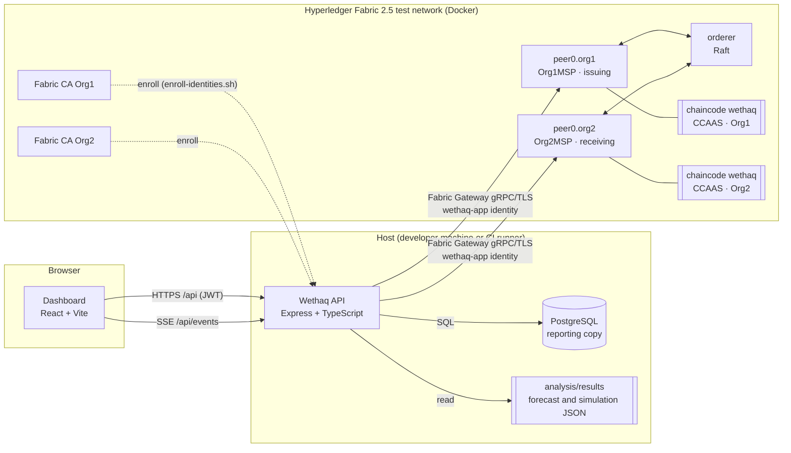
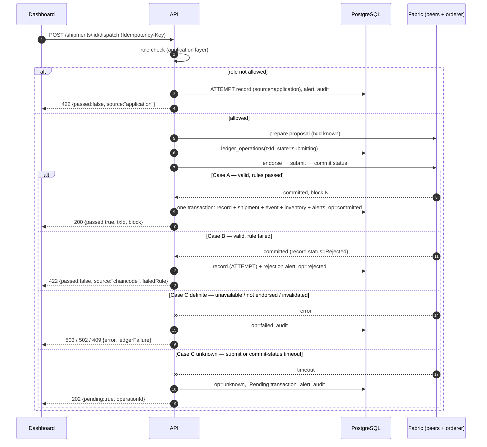
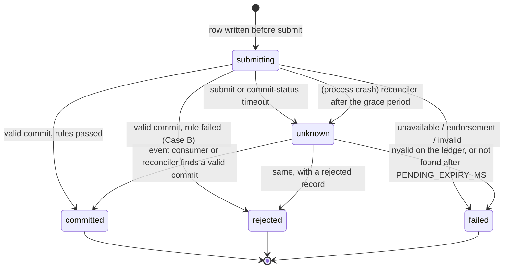
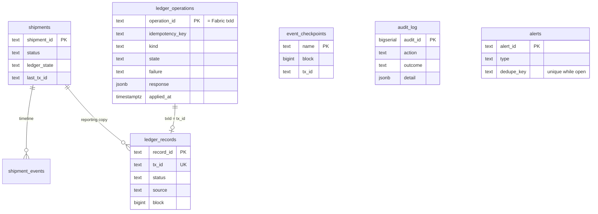

# Wethaq GP482 — Backend, blockchain and integration architecture

This document describes the system as it is implemented in this repository. Every behaviour described
here is in the code and covered by the tests listed in [FINAL_TEST_REPORT.md](FINAL_TEST_REPORT.md).
The GP481 report is unchanged; differences from its design are listed at the end.

## 1. System context

* **Demo mode** (the public Vercel build, `VITE_WETHAQ_LIVE` unset) runs entirely in the browser with synthetic data and
  never calls the API. It is unchanged by GP482 work.
* **Live mode** (`npm run dev:live`) talks to the API only. It never falls back to the bundled mock data: inventory,
  shipments, transactions, alerts and users all come from the API.
* The API runs with `LEDGER_MODE=fabric` (Hyperledger Fabric) or `LEDGER_MODE=local` (the **local development ledger**:
  the same rules in PostgreSQL, with no peers, endorsement or ordering). Fabric mode never falls back to the local ledger.

## 2. Fabric network

| Item | Value |
|---|---|
| Fabric / Fabric CA | 2.5.12 / 1.5.15 (`fabric/install.sh`) |
| Organizations | Org1MSP (issuing: dispatch, in-transit, planner registration), Org2MSP (receiving: receipt), OrdererOrg |
| Identities | Generated by **Fabric CA** (`network.sh up -ca`); the API's identity `wethaq-app` (type `client`) is registered and enrolled from each org's CA by `fabric/enroll-identities.sh` into `fabric/identities/` (git-ignored, mode 700) |
| Channel | `wethaq` (`FABRIC_CHANNEL`) |
| Chaincode | `wethaq`, TypeScript, chaincode-as-a-service (one container per peer, restart policy `unless-stopped`) |
| Endorsement policy | `AND('Org1MSP.peer','Org2MSP.peer')` |
| Orderer `BatchTimeout` | 500 ms (sample default 2 s) |

Scripts (all in `fabric/`, all re-use `lib.sh`):

| Script | Purpose |
|---|---|
| `setup.sh` / `install.sh` | Download Fabric samples, binaries and images (one time), pinned: samples commit, SHA-256 per archive, image digests |
| `up.sh [--recreate]` | Fresh network with CAs → channel → chaincode → identities → `verify-network.sh`. Refuses to replace an existing network without confirmation |
| `deploy-chaincode.sh [version] [sequence]` | Build the chaincode image and deploy it (CCAAS) |
| `upgrade-chaincode.sh [version]` | Deploy the current source as the next sequence |
| `enroll-identities.sh` | Register and enroll `wethaq-app` with each org's CA (idempotent) |
| `verify-network.sh` | Containers, channel membership, committed definition with both approvals, a chaincode query, certificate expiry |
| `stop.sh` / `start.sh` | Stop / start the containers, keeping the ledger |
| `reset.sh` | Remove the network, its ledger and the application identities; asks you to type `reset` (or `--yes`). It removes the Wethaq chaincode containers and runs the samples' `network.sh down`, which removes the test network's containers and volumes, containers labelled `service=hyperledger-fabric`, `dev-peer*` containers and images, and stops containers whose name contains `ccaas`. No other Docker resources are touched |

## 3. Chaincode

`chaincode/shipment/src/contract.ts`, rules in `rules.ts` (shared with the API so the API can explain a rejection the
same way the chaincode does).

| Function | Kind | Notes |
|---|---|---|
| `RegisterShipment(id, partId, qty)` | submit | Org1 only |
| `Dispatch` / `MarkInTransit` / `Receive` | submit | Applies the five rules in priority order. A failed rule still **commits** a record with `status = Rejected` (Case B) and leaves the shipment unchanged |
| `ReadShipment(id)` | evaluate | World state of one shipment |
| `GetHistory(id)` | evaluate | All records of a shipment |
| `ReadTransactionRecord(txId)` | evaluate | The record written by one transaction (index key `tx~txId`) |
| `QueryTransactionRecords(shipmentId, operation, status, pageSize ≤ 200, bookmark)` | evaluate | Paginated, filtered |
| `VerifyShipment(id, expectedJson)` | evaluate | Compares an off-chain copy on the peer and returns the differences |

Events: `ShipmentRegistered`, `ShipmentUpdated`, `OperationRejected` (payload = the record).

## 4. Transaction outcomes

## 5. Synchronization between Fabric and PostgreSQL

* **Applied exactly once.** `applyRecord` inserts the reporting record with primary key `TX-<first 12 hex of txId>`
  and a unique `tx_id`, `ON CONFLICT DO NOTHING`. Status, timeline, inventory and alerts change **in the same
  database transaction, only when that insert happened**. The API's own response path, the event consumer and the
  reconciler can all see the same transaction without applying it twice.
* **Event consumer.** Follows the chaincode events of every block (`getChaincodeEvents`), resumes from the
  `event_checkpoints` row `ledger-events` after a restart, reconnects every 3 s if the stream drops, and also applies
  transactions submitted by **other clients** of the network (attributed to their organization, user `… (ledger client)`).
* **Reconciler.** Runs at start-up and every `RECONCILE_INTERVAL_MS` (default 30 s). For each operation that is
  `unknown`, or `submitting` for longer than 2 minutes (a crash), it asks the ledger: `qscc GetTransactionByID`
  (validation code and block) and `ReadTransactionRecord`. Valid → applied; invalid → failed; not found after
  `PENDING_EXPIRY_MS` (default 5 min) → failed. While the ledger is unreachable nothing is decided and one
  `Ledger sync` alert is kept open.
* **Pending requests.** A new shipment request is written with `ledger_state = pending` and only becomes `confirmed`
  when its registration commits. It is removed only when the failure is certain; otherwise it stays visible
  (`pending`, then `failed` if the ledger never committed it). Operations on a pending shipment answer 409.
* **Idempotency.** `Idempotency-Key` (8–128 chars) is stored per user; a repeat returns the stored response (or the
  pending response) instead of submitting again. The live dashboard sends a new key for each user action.
* **Alerts** have a `dedupe_key` with a partial unique index on open alerts: one shortage alert per part and
  location, one pending alert per transaction, one sync alert while the ledger is unreachable.

## 6. Verification

`GET /api/shipments/:id/verify` returns `status`:

| Status | Meaning |
|---|---|
| `verified` | The PostgreSQL copy (part, quantities, status, last transaction id) matches the ledger state |
| `mismatch` | It differs; `differences` lists each field |
| `not_found` | The ledger has no state for this shipment |
| `pending` | A ledger transaction for this shipment is not confirmed yet |
| `ledger_unavailable` | The ledger could not be reached; nothing was verified |
| `failed` | The ledger registration of this request was never committed |

In Fabric mode the comparison runs on the peer (`VerifyShipment`).

## 7. Inventory and analytics

* `GET /api/inventory` (and `inventory` in `/api/state`) computes positions from the PostgreSQL stock levels plus stock
  already dispatched to each location, with the dashboard's policy (`services/inventory.ts`). Dispatch decreases the
  origin's stock and a receipt increases the destination's, once per committed transaction; then a shortage check runs.
* `GET /api/analytics` and `/api/analytics/:name` serve `analysis/results/*.json` **unchanged**, with the file, the
  script that produced it, the dataset, the modification time and the SHA-256. The forecasting model is scikit-learn's
  `HistGradientBoostingRegressor` (Poisson loss); XGBoost was not used. The inventory simulation runs on the
  synthetic panel and does not show real-world savings.
* `GET /api/analytics/v1/*` reads the same files and returns filtered views, each with the provenance of the files
  it used: `datasets` (RAF real and synthetic, kept apart), `methods`, `parts?class=&q=`,
  `parts/:id/forecast?method=&horizon=1..6`, `metrics?dataset=&split=&method=`, `classification`,
  `model-comparison`, `rolling?method=`, `inventory-simulation?policy=&class=`, `inventory-policies`, `provenance`.
  Invalid filters answer 400, a part without exported forecasts 404.
* In live mode the Forecasts and Overview pages load the RAF results from the API (`src/data/useRafData.ts`), show a
  loading state, and show an error rather than the bundled copy when the API cannot provide them. The page shows the
  file name and the first 8 characters of its SHA-256.

## 8. Security

* JWT (HS256, algorithm pinned on verification) sessions; bcrypt passwords; temporary passwords that expire and must
  be replaced at first sign-in; rate-limited sign-in and password change; helmet headers on the API.
* Sessions end on the server: every token carries an id (`jti`) and the user's session version. `POST /api/auth/logout`
  records the id in `revoked_tokens`; a password change or an administrator's reset increments `users.session_version`,
  which ends every other session of that user (migration 005).
* `NODE_ENV=production`: role switching and demo tools are forced off; `JWT_SECRET` must be ≥ 32 random characters;
  `DEMO_PASSWORD` is refused; `CORS_ORIGIN` must be a single origin (`*` is refused). A real installation starts from
  `npm run bootstrap` (reference data and one administrator, no demonstration accounts).
* Audit log (`audit_log`, `GET /api/admin/audit`, filtered and paged): sign-ins (success and failure), sign-out,
  password changes, user changes, application-level refusals, ledger failures and unknown outcomes, reconciliation,
  consistency checks, checkpoint resets and the bootstrap. A row trigger (`audit_log_no_update`, migration 004)
  refuses every UPDATE and DELETE. The table owner can still drop the trigger or TRUNCATE the table (the demonstration
  seed's `--reset` does), so this guards against application errors, not against a database administrator. No secrets
  are stored.
* Structured JSON logs with a request id (`X-Request-Id`) and redaction of password, token, secret, key and
  authorization fields.
* Fabric: the API signs with a CA-enrolled **client** identity per organization (not an admin). Private keys stay in
  `fabric/identities/` (git-ignored, mode 600); the CI secret scan fails on tracked keys, `.env` files or identity
  folders. A client identity, or one superseded certificate, can be revoked with `fabric/revoke-identity.sh`, which
  puts the CRL into the organization's MSP definition on the channel (run in a drill with a disposable identity).
* The single-server configuration (`deploy/`) publishes only the web server; PostgreSQL and the API stay on internal
  Docker networks, the API container mounts only the peers' TLS CA certificates and its own identities, and Caddy
  adds HTTPS, HSTS and a Content-Security-Policy. The full review is in [SECURITY_AUDIT.md](SECURITY_AUDIT.md).

## 9. Limitations

* One application identity per organization, not one Fabric identity per dashboard user. The ledger shows which
  organization submitted a transaction; the API's audit log shows which user asked for it.
* The Fabric network is the single-host test network (one peer per organization, one Raft orderer). It is not a
  production deployment, and nothing has been deployed outside the developer machine (GitHub-hosted CI runs start
  it temporarily for tests). Actual cloud deployment is intentionally deferred until GP2; the arm64 target is
  described in [ORACLE_CLOUD_READINESS.md](ORACLE_CLOUD_READINESS.md).
* A transaction id that the ledger never received is marked failed after `PENDING_EXPIRY_MS`. The API never re-sends a
  signed envelope, so it cannot commit later through this API.
* The local development ledger is for development and tests only and is not Hyperledger Fabric.
* No IoT, GPS or sensor data; a committed transaction records a permitted workflow step, not physical delivery.
* Cancellation and return workflows (GP481 §6.6, item 5) are not implemented. A receipt of fewer items than were
  dispatched is accepted and raises a Discrepancy alert, but the rest cannot be received later (the no-duplicate rule
  allows one receipt per shipment). See [REMAINING_BLOCKERS.md](REMAINING_BLOCKERS.md).
* Diagrams for components, sign-in, data flow, Fabric topology and the shipment lifecycle are in [DIAGRAMS.md](DIAGRAMS.md);
  deployment, rollback and troubleshooting in [DEPLOYMENT_GUIDE.md](DEPLOYMENT_GUIDE.md); backup, restore, revocation
  and recovery in [BACKUP_AND_RECOVERY.md](BACKUP_AND_RECOVERY.md).
