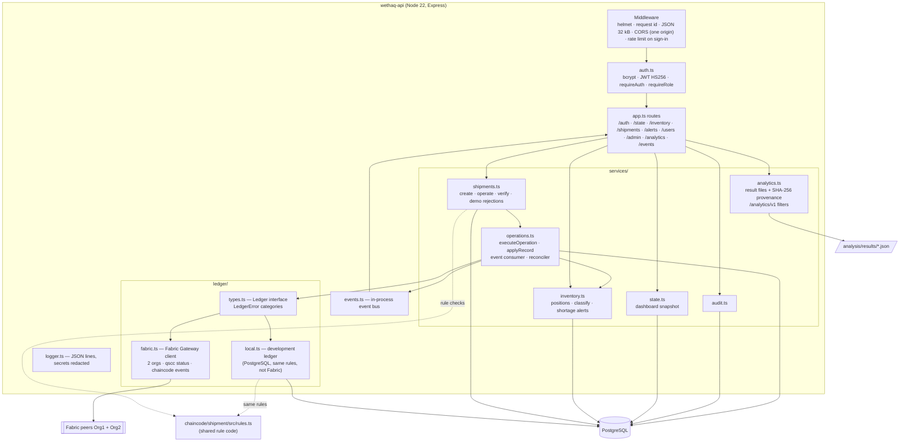
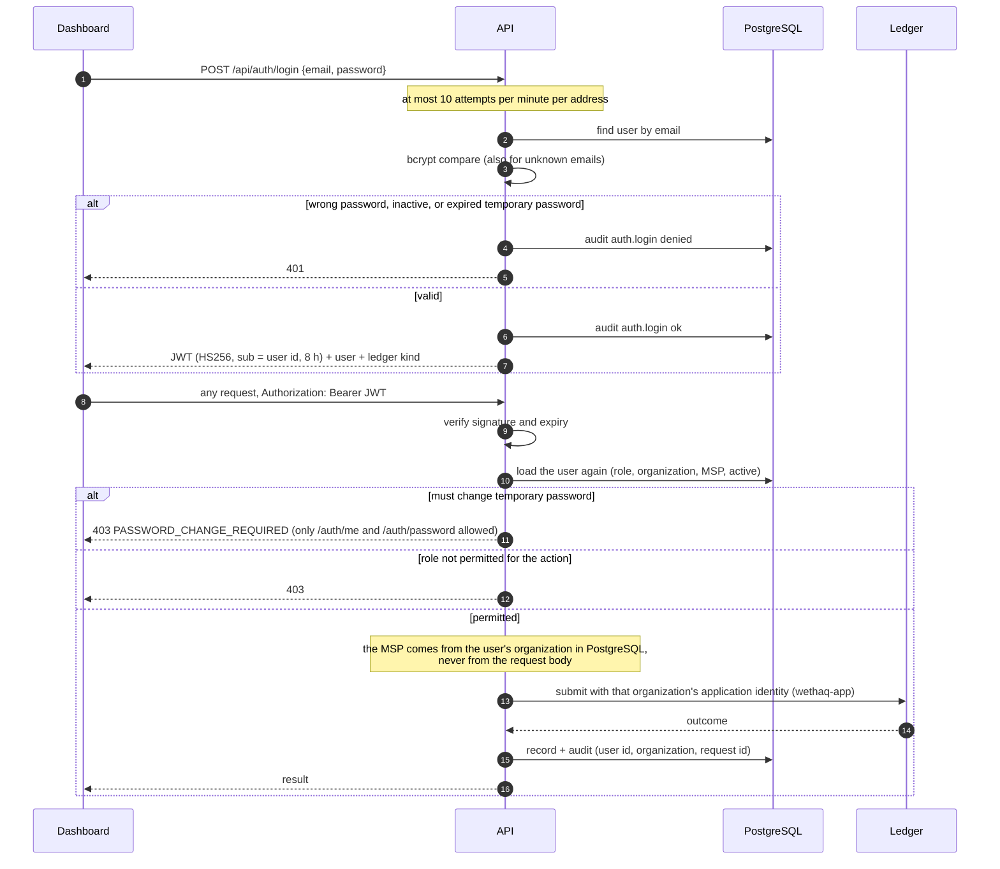
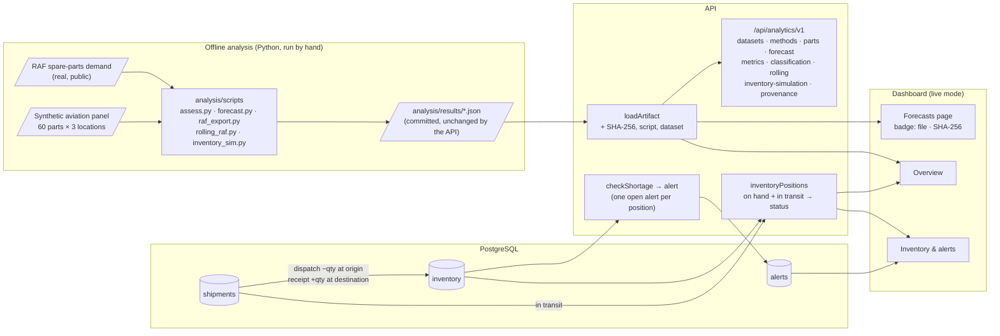
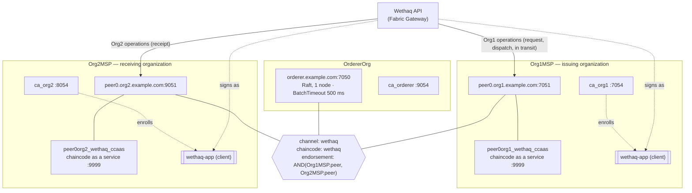
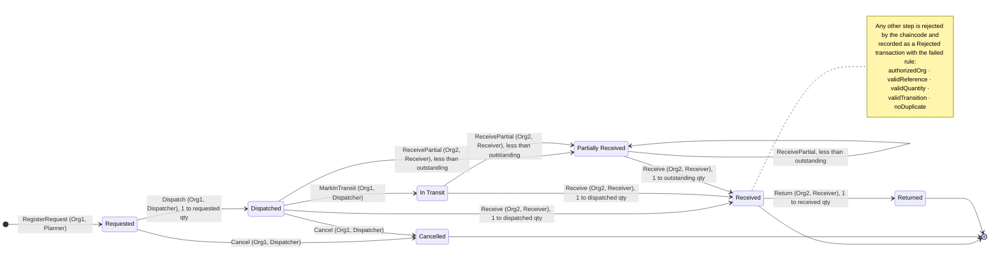

# Wethaq GP482 — diagrams

All diagrams are Mermaid (they render on GitHub) and describe the code in this repository. Four are in
[ARCHITECTURE.md](ARCHITECTURE.md) next to the text they illustrate, one is in [DEPLOYMENT_GUIDE.md](DEPLOYMENT_GUIDE.md), and
the other five are below.

| # | Diagram | Where |
| --- | --- | --- |
| 1 | System context | [ARCHITECTURE.md §1](ARCHITECTURE.md#1-system-context) |
| 2 | Ledger transaction sequence (request → endorsement → commit → PostgreSQL) | [ARCHITECTURE.md §4](ARCHITECTURE.md#4-transaction-outcomes) |
| 3 | Ledger operation states (Case A/B/C, reconciliation) | [ARCHITECTURE.md §4](ARCHITECTURE.md#4-transaction-outcomes) |
| 4 | PostgreSQL data model | [ARCHITECTURE.md §5](ARCHITECTURE.md#5-synchronization-between-fabric-and-postgresql) |
| 5 | Deployment | [DEPLOYMENT_GUIDE.md §1](DEPLOYMENT_GUIDE.md#1-deployment-architecture) |
| 6 | Backend components | [below](#6-backend-components) |
| 7 | Sign-in and authorization | [below](#7-sign-in-and-authorization) |
| 8 | Forecasting and inventory data flow | [below](#8-forecasting-and-inventory-data-flow) |
| 9 | Fabric network topology | [below](#9-fabric-network-topology) |
| 10 | Shipment lifecycle and the rules the chaincode enforces | [below](#10-shipment-lifecycle) |

## 6. Backend components

`LEDGER_MODE` picks `fabric.ts` or `local.ts` once at start-up; Fabric mode never falls back to the local ledger.

## 7. Sign-in and authorization

The application identity is a service identity per organization: the dashboard user is recorded with each
operation (ledger record and audit log), but users do not sign transactions with keys of their own.

## 8. Forecasting and inventory data flow

The forecasting results are precomputed and served as they are; the API does not train or run a model. In demo
mode the dashboard uses the same files bundled into the build; in live mode it reads them from the API and shows an
error, not the bundled copy, when the API cannot provide them.

## 9. Fabric network topology

Every transaction needs an endorsement from a peer of each organization before the orderer puts it in a block.
This is the fabric-samples test network on one machine: one peer per organization and one orderer, so it shows the
permissioned workflow but is not a fault-tolerant production network.

## 10. Shipment lifecycle

Partial receipts, cancellation and returns were added in chaincode version 2 (GP2) and are offered in live mode only. A final receipt that leaves the total below the dispatched quantity is accepted and raises a *Receipt quantity mismatch* alert. A role
that may not perform an operation is refused by the API before anything reaches the ledger; that attempt is stored
off-chain as a rejected attempt with an alert and an audit entry.
